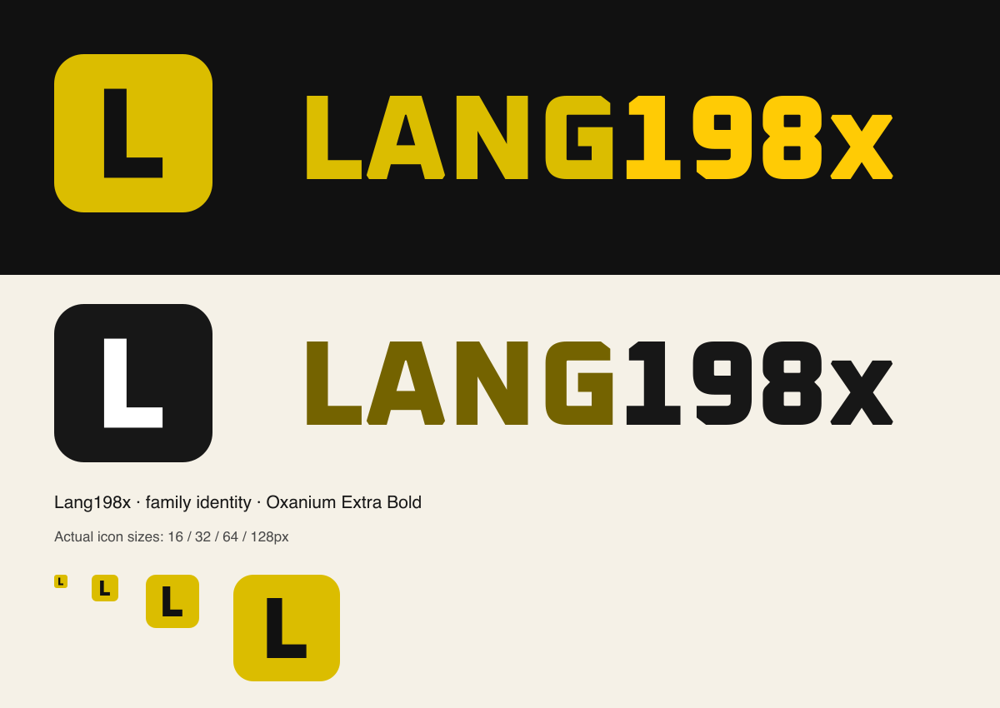

# Lang198x identity

A genuine Oxanium Extra Bold **L**, using the same 64-unit rounded tile and
centred 36-unit lettering as the sibling icons. The wordmark uses the family
font's actual glyphs and kerning. No generated or approximated alphabet is used.



## Files

- `assets/lang-icon-colour.svg`: scalable colour initial tile.
- `assets/lang-icon-128.png` and `lang-icon-512.png`: transparent PNG exports,
  including the Marketplace's requested 128px size.
- `assets/lang-icon-black.svg` and `lang-icon-white.svg`: monochrome tiles.
- `assets/lang-{colour,light,black,white}.svg`: outlined wordmarks; no installed
  font is needed to display them.

The L, wordmark and golden palette were approved on 2026-10-20. The assets are
ready for use; account uploads and extension packaging are separate steps.

## Colour reasoning

The family's fixed hue list has two equally wide 45-degree gaps: 75–120 and
330–15. Lang takes the first, at **97.5 degrees**, placing Lang between
Build's orange and Play's lime rather than adding another pink near Debug and
Forge. Existing sibling colours stay fixed.

At that hue, the maximum in-gamut sRGB chroma at OKLCH lightness 0.50 yields
`#746300` after 8-bit rounding (chroma about 0.103205). For display artwork,
lightness 0.80 yields `#dbbd00` (chroma about 0.165128). This display lightness is the approved
Lang artwork treatment; the page-ink lightness and unused-gap placement follow
the family rule. The suffix remains `#ffcb05` on dark backgrounds
and `#171717` on light backgrounds. Logo colours are not reading-text tokens.

## Construction and verification

Run `python3 build.py` from any working directory with the already available
fontTools. It verifies the source font hash, rejects missing glyphs, validates
SVG XML and lettering bounds, and checks the L's ink centre.

`build.py` reuses the glyph extraction and pair-adjustment functions from the
umbrella's `docs/plans/2026-10-05-logo-suite/vectors/build.py`. The unchanged
Oxanium source has SHA-256
`2ce01d946e1e1ffc8d7eecfffbda8623bedd63eaf811a20488c4b69af45babb0`.
Its SIL Open Font License is retained in `fonts/OFL.txt`.

PNG exports use the existing renderer:

```sh
rsvg-convert -w 128 -h 128 assets/lang-icon-colour.svg -o assets/lang-icon-128.png
rsvg-convert -w 512 -h 512 assets/lang-icon-colour.svg -o assets/lang-icon-512.png
rsvg-convert preview.svg -o preview.png
```

The preview includes actual 16/32/64/128px specimens. Native vectors were used;
no image-generation tool, new dependency or system font installation was needed.
